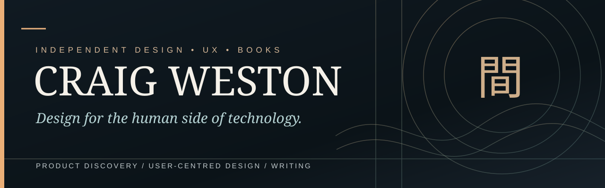
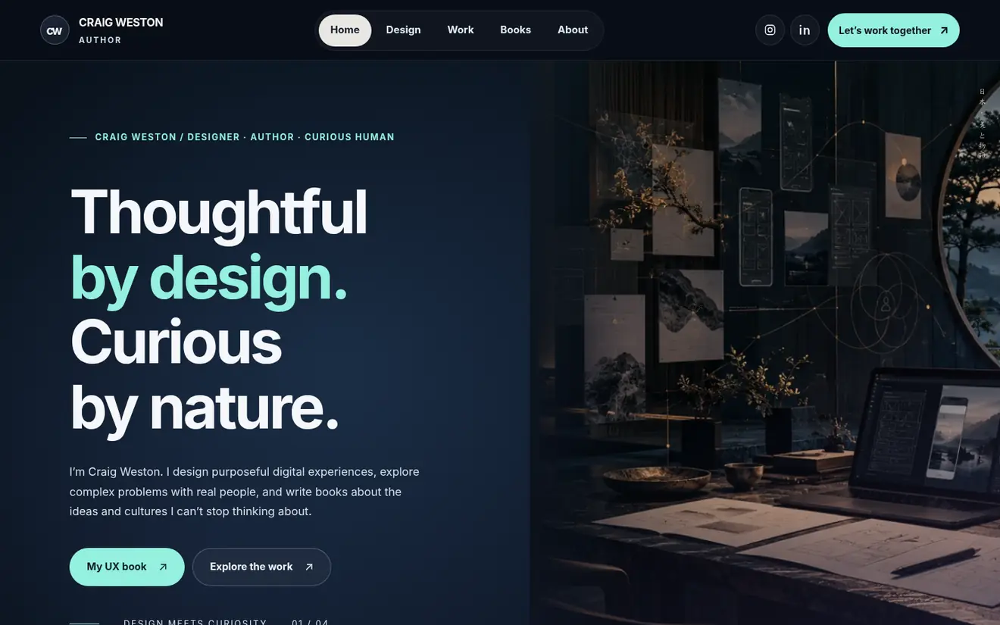
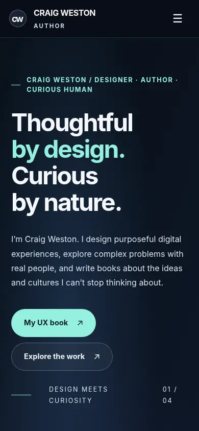
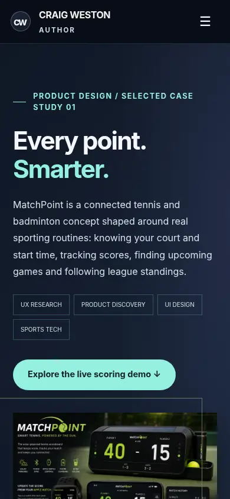
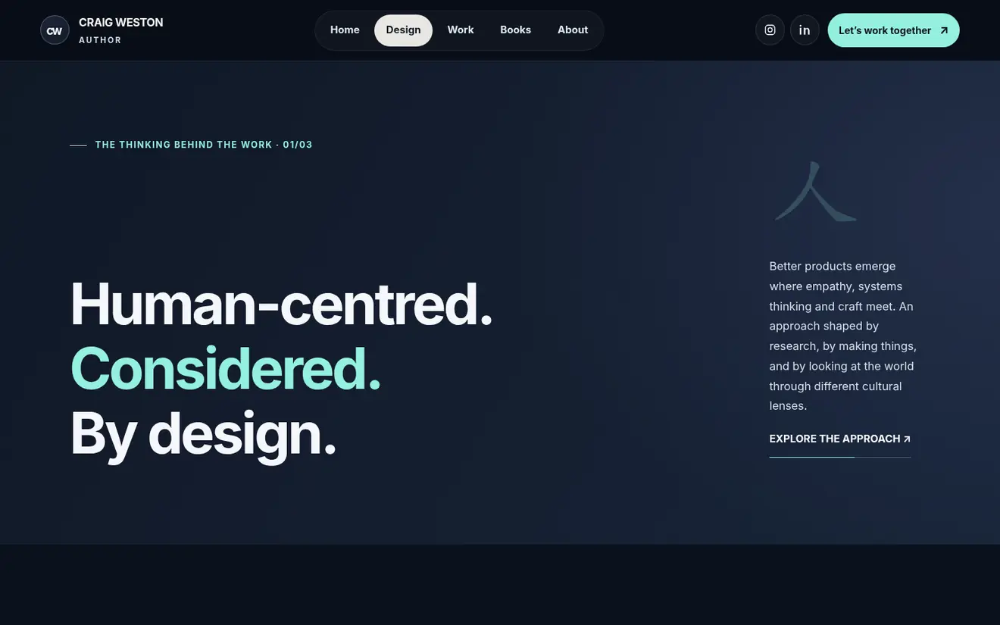
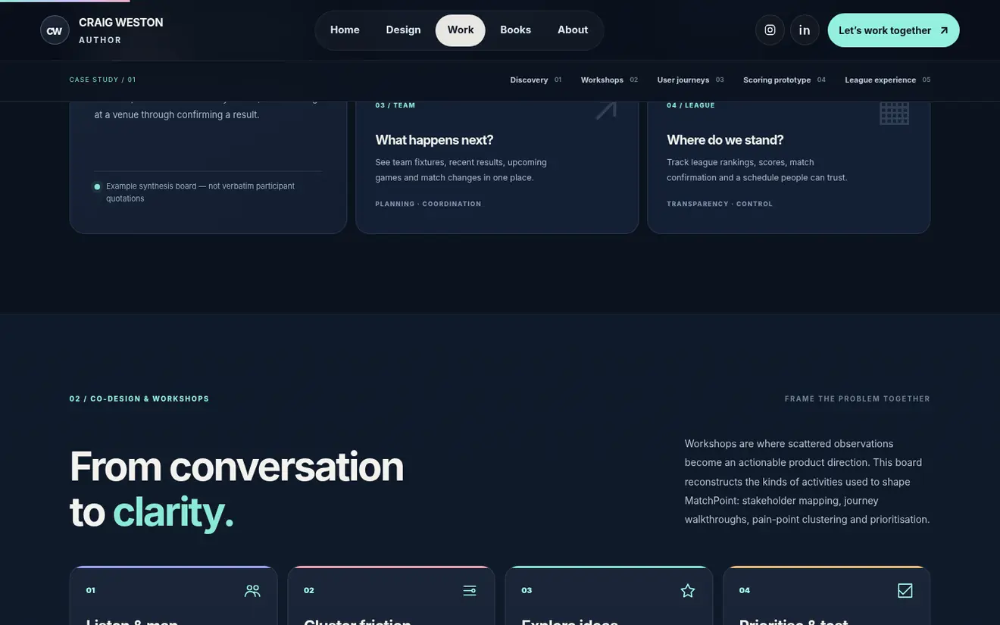
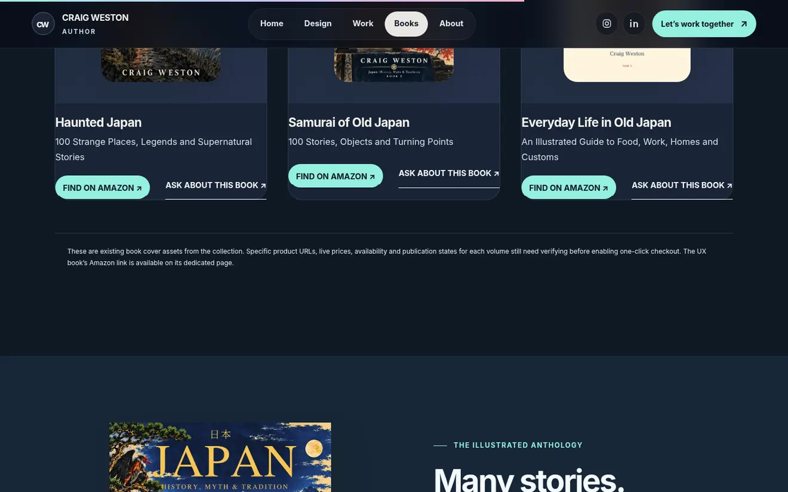

<div align="center">



# Craig Weston · Portfolio & Books

**An independent portfolio about thoughtful products, user-centred design and an enduring curiosity about Japan.**

[**Explore the website**](https://craigweston.co.uk) · [**MatchPoint case study**](public/matchpoint.html) · [**Design thinking**](public/design.html) · [**About Craig**](public/about.html)

   

</div>

> **Design principle**  
> Good design makes the important things easier to notice, understand and do. Everything else should earn its place.

---

## 01 / The project at a glance

This site is a living portfolio and author hub for **Craig Weston**, bringing together three strands of work: **product discovery and UX**, **hands-on design exploration**, and **books on design and Japanese culture**. It is deliberately lightweight: no framework, no client-side router, no database and no paid build service.

<table>
<tr>
<td width="67%"></td>
<td width="33%" valign="top"><strong>Design direction</strong><br><br>Dark editorial surfaces, warm paper-coloured typography, botanical teal, restrained gold accents, generous spacing and carefully paced motion.<br><br><strong>Responsive</strong><br><br>Mobile-first layouts and visible focus states.<br><br><strong>Philosophy</strong><br><br>Japanese principles such as <em>間</em> (ma) and <em>簡素</em> (kanso) inform the rhythm and clarity.</td>
</tr>
</table>

### Find your way around

| Page | Visitor question | URL |
|:---|:---|:---|
| **Home** | Who is Craig, and what does he do? | [`/`](public/index.html) |
| **Design** | How does he approach research and user-centred design? | [`/design.html`](public/design.html) |
| **Work / MatchPoint** | What does his product discovery process look like in practice? | [`/matchpoint.html`](public/matchpoint.html) |
| **Books** | What has he published? | [`/books.html`](public/books.html) |
| **UX Is Dead, Long Live UX** | What does he think the future of UX looks like? | [`/ux-book.html`](public/ux-book.html) |
| **Japan collection** | What are the folklore and cultural books? | [`/japan-books.html`](public/japan-books.html) |
| **About** | What informs his approach and what is he like to work with? | [`/about.html`](public/about.html) |

<details><summary><strong>See the mobile design</strong></summary>

<br>

<table><tr><td align="center"></td><td align="center"></td></tr></table>

</details>

---

## 02 / Inside the experience

<table>
<tr><td width="50%"><br><strong>User-centred design</strong><br>How discovery, research, synthesis, prototyping and validation inform decisions.</td><td width="50%"><br><strong>MatchPoint</strong><br>Interactive player, captain and league-organiser journeys with score tracking and prototype fixtures.</td></tr>
<tr><td colspan="2"><br><strong>Japan: History, Myth & Tradition</strong><br>A browsable illustrated collection shaped by a long-standing interest in Japanese stories, culture and visual language.</td></tr>
</table>

### What is genuinely interactive?

- **MatchPoint scoring:** working tennis/badminton scoring concept with point controls, undo and reset.
- **Role-based journeys:** switch among player, team captain and league organiser flows and view the rationale behind design choices.
- **Fixtures and standings:** interactive sample views and filters that explain product information architecture.
- **Design method:** keyboard-operable four-stage discovery-to-validation walkthrough.
- **Japan catalogue:** filter and explore illustrated titles.
- **Project enquiry:** pre-filled email draft via the visitor's configured email application (there is **no backend form submission**).

> **Research integrity:** MatchPoint workshop outputs, fixtures, leagues and interface states are **illustrative concept artefacts**, not verified customer quotes, interview counts, production performance metrics or evidence of a released commercial service.

---

## 03 / Run it locally

### Requirements

- Git and a modern browser.
- Python 3 for the dependency-free checks and simple development web server.
- No Node.js dependencies or `npm install` step are required.

```bash
# Clone the repository
git clone https://github.com/craig-weston/craigweston-website.git
cd craigweston-website

# Run the repository's own static-file checks
python3 scripts/check_site.py

# Serve the site from its production output directory
python3 -m http.server 8000 --directory public
```

Visit **http://localhost:8000** in your browser. Stop the server with `Ctrl+C`.

**Why a local server?** It gives you predictable relative URLs and behaviour, rather than relying on browser rules for `file://` pages. The entire deployable website is contained in `public/`.

### Structure

```text
craigweston-website/
├── README.md                   # This illustrated guide
├── DEPLOY.md                   # Cloudflare deployment runbook
├── ACCESSIBILITY-REVIEW.md    # Accessibility checks and caveats
├── BOOK-LINKS.md              # Book link verification notes
├── CONTENT-NOTES.md           # Editorial and research caveats
├── docs/
│   └── images/                # README screenshots and diagrams
├── .github/
│   └── workflows/ci.yml       # GitHub Actions static checks
├── scripts/
│   └── check_site.py          # Dependency-free site validation
└── public/                    # Published as the site root
    ├── index.html
    ├── design.html
    ├── matchpoint.html
    ├── books.html
    ├── ux-book.html
    ├── japan-books.html
    ├── about.html
    ├── assets/                # Optimised WebP artwork and favicon
    ├── *.css                  # Base, editorial and enhancement styles
    ├── *.js                   # Page interactions
    ├── _headers               # Cloudflare Pages HTTP headers
    ├── _redirects             # Cloudflare Pages redirects
    ├── robots.txt
    └── sitemap.xml
```

### Making edits

| To change… | Edit… | Before publishing… |
|:--|:--|:--|
| Text, structure or page metadata | `public/<page>.html` | Check headings, links and mobile wrapping |
| Global typography / layout | `public/styles.css` and layered CSS | Check every page, not just Home |
| New interaction or motion | JS files in `public/` | Test keyboard, touch and reduced-motion preferences |
| Book covers or artwork | `public/assets/` | Optimise size and retain meaningful alt text |
| New page | HTML + navigation + `sitemap.xml` | Update this README and the `scripts/check_site.py` page list |

---

## 04 / Cloudflare Pages — automatic publishing


The **`main`** branch is the source of truth. Cloudflare Pages connects directly to GitHub and deploys new pushes. GitHub Actions independently validates the repository, but the workflow is **not** a deploy script and does **not** gate the Cloudflare build automatically.

### First-time setup (once)

1. Sign in to the [Cloudflare dashboard](https://dash.cloudflare.com/) and open **Workers & Pages**.
2. Choose **Create application → Pages → Connect to Git** (wording may vary as Cloudflare updates the dashboard).
3. Authorise the **Cloudflare Workers & Pages** GitHub application if prompted and grant it access to `craig-weston/craigweston-website`.
4. Select the repository and use these build settings:

   | Setting | Value |
   |:--|:--|
   | Project name | `craigweston-website` |
   | Framework | None / static site |
   | Production branch | `main` |
   | Root directory | `/` (repository root) |
   | Build command | `exit 0` |
   | Build output directory | `public` |

5. Save and deploy; Cloudflare provides a temporary `*.pages.dev` address. **Review this address before changing the main website domain.**
6. Test `/`, `/design.html`, `/matchpoint.html`, `/books.html`, `/ux-book.html`, `/japan-books.html` and `/about.html`; check images, motion and working interactions.
7. In your Pages project, open **Custom domains → Set up a custom domain** and add `craigweston.co.uk`. Follow Cloudflare's DNS prompts. If the zone is already in Cloudflare, the dashboard may handle the required record automatically.
8. Wait for the domain and HTTPS certificate to become active, then test `https://craigweston.co.uk` and confirm all seven routes load.

**Do not blindly delete or overwrite existing DNS entries.** Before connecting the live domain, inspect existing records and verify the `*.pages.dev` version works. When replacing an existing website, schedule the DNS cutover intentionally.

### Publish a change (every time)

```bash
# Make changes and test locally
python3 scripts/check_site.py

git add .
git commit -m "Improve accessible navigation and content"
git push origin main
```

Cloudflare Pages will build and deploy the new `main` commit automatically **once Git integration is configured**. Pull requests and non-production branches may receive preview deployments depending on your Pages branch settings.

### Rollback & troubleshooting

| Symptom | What to check |
|:--|:--|
| Blank page / 404 | `public/index.html` exists; output folder is **`public`**, not `/` or `dist` |
| Images missing | Paths begin with `assets/` or `/assets/`; filenames are case-sensitive |
| No deployment on push | Pages → **Settings → Builds → Git repository**; branch control and app access |
| Git integration permissions error | GitHub → **Settings → Applications → Installed GitHub Apps**; configure Cloudflare repo access |
| Build fails | Cloudflare deployment log; ensure build command is `exit 0` |
| Domain not resolving | Pages custom domain status; Cloudflare DNS record and certificate provisioning |
| A change broke production | Use Pages deployment history to roll back, or revert the Git commit and push |

Read **[DEPLOY.md](DEPLOY.md)** for the longer deployment and DNS checklist.

---

## 05 / Accessibility and quality

Accessibility is a continuous practice, not a badge earned with one automated scan. This project aims for **WCAG 2.2 AA**, with deliberate attention to readability, semantics and motion comfort.

| Area | What is implemented / checked | Follow-up |
|:--|:--|:--|
| Text readability | Contrast refinements and automated text sampling across the seven pages | Run a full colour/token audit, including hover and error states |
| Keyboard | Focus styles and interactive walkthrough keyboard checks | Manual keyboard-only traversal of every page |
| Motion | Reduced-motion preferences considered in animations | Recheck animations when adding new effects |
| Mobile | Tested at desktop and narrow-phone sizes; no horizontal overflow in sampled views | Cross-browser and real-device QA |
| Semantics | One H1 and page title per page checked by `check_site.py`; image alt text where relevant | Audit headings, landmarks, forms and ARIA usage |
| Screen readers | Semantic markup is intended to assist users | **Human screen-reader testing still required** |

**Validation command:** `python3 scripts/check_site.py` checks existence, a single page title/H1, internal assets and selected production artefacts. It is a *static integrity check*, **not** a complete WCAG or accessibility certification. For a release audit, also run Axe DevTools or Lighthouse and perform manual keyboard, zoom (200–400%), contrast and screen-reader checks.

Read the honest test summary in **[ACCESSIBILITY-REVIEW.md](ACCESSIBILITY-REVIEW.md)**.

---

## 06 / Content, licences and editorial notes

- Text and books are © **Craig Weston** unless credited otherwise. This repo isn't a general licence to republish manuscript extracts or cover artwork.
- *UX Is Dead, Long Live UX* includes **short extracts** grounded in the author-supplied manuscript. Do not substitute invented passages.
- Japanese terms and examples are explained in context. Use authentic script carefully; do not treat cultural concepts as interchangeable visual decoration.
- MatchPoint represents a **product/design exploration**. Where data or workshop artefacts are not verified, they are labelled as examples.
- Amazon links and product availability may change; check links before launch. Individual store links are noted in [BOOK-LINKS.md](BOOK-LINKS.md).
- No ecommerce backend, payment system or server-side form processing is implemented. Don't promise those features without adding them.

### Links

[Instagram — @craigwestonactually](https://www.instagram.com/craigwestonactually/) · [LinkedIn — Craig Weston](https://www.linkedin.com/in/craig-weston/) · [UX book on Amazon UK](https://www.amazon.co.uk/dp/B0HN889S5K)

---

<div align="center">

<sub>Designed around attention, curiosity and human experience · 2026 · Craig Weston</sub>

</div>
